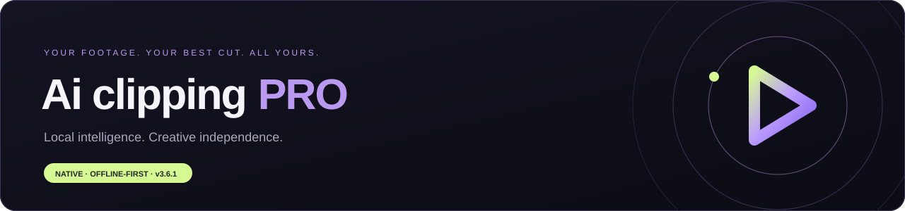
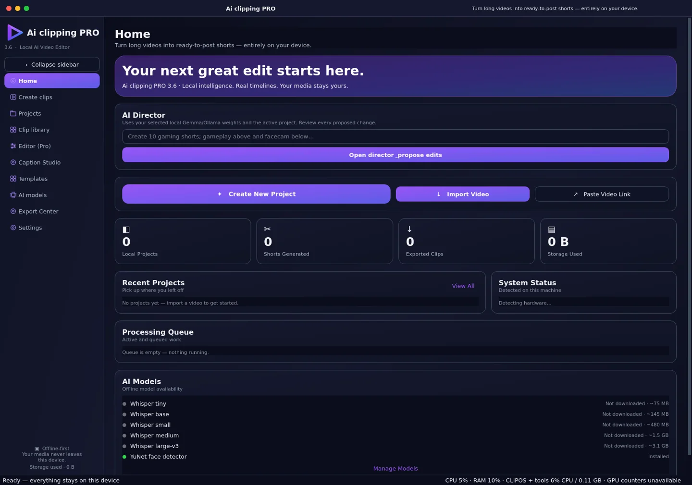
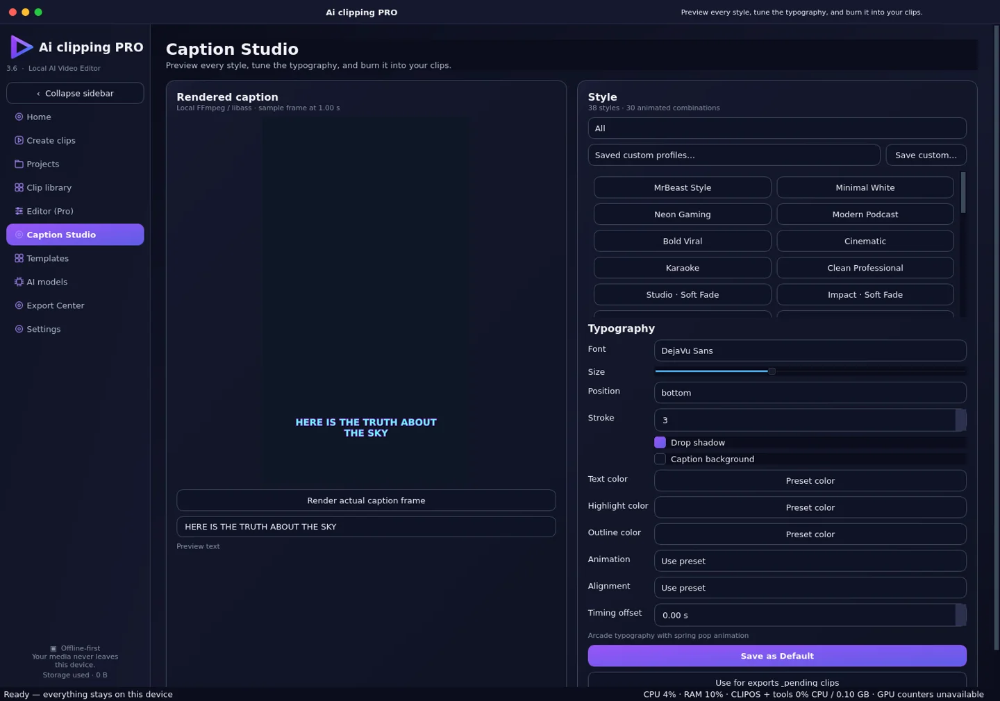
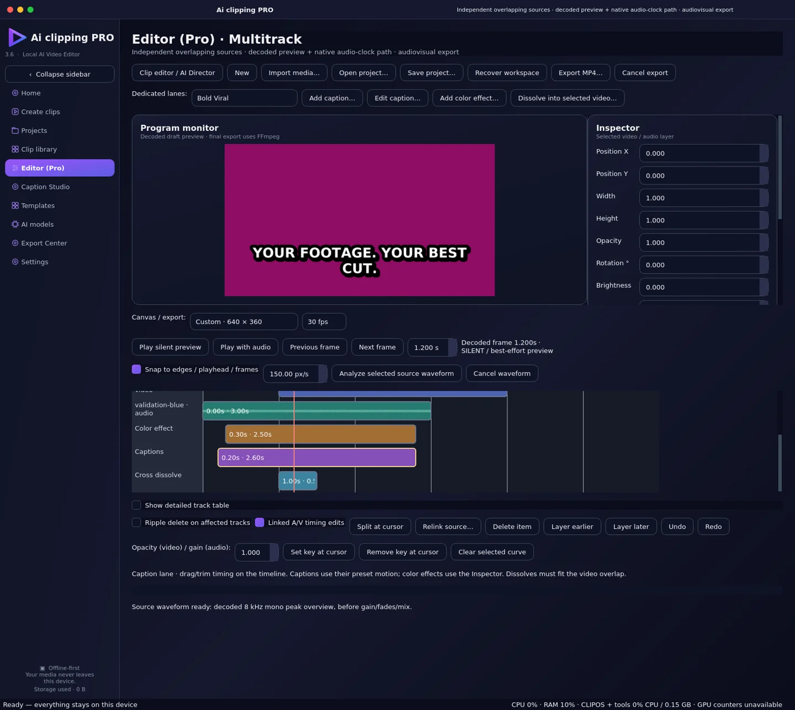

<div align="center">



# Ai clipping PRO

**Your footage. Your best cut. All yours.**

An offline-first native video workspace by **Analoggeek**. Find your moments,
shape your captions, edit real timelines and export local files—without a mandatory
cloud account, upload or subscription.

**[Explore the website ↗](https://analoggeek.github.io/AiFreeClipping/)** ·
**[Download v3.6.1 ↓](#download)** ·
**[Quick start](#quick-start)** ·
**[What works](#features)** ·
**[Support](https://github.com/Analoggeek/AiFreeClipping/issues)**

**LATEST RELEASE: v3.6.1** · Windows · Apple Silicon · Intel Mac · Linux

</div>

---

## Download

Choose your platform. Every link below is a direct download from the official
**v3.6.1** release—no download manager or account required.

| Your system | Installer | Alternative |
| :--- | :--- | :--- |
| **Windows 10 / 11 · x64** | [**Download EXE ↓**](https://github.com/Analoggeek/AiFreeClipping/releases/download/v3.6.1/CLIPOS-Setup.exe) | — |
| **macOS · Apple Silicon** | [**Download ARM64 DMG ↓**](https://github.com/Analoggeek/AiFreeClipping/releases/download/v3.6.1/CLIPOS-3.6.1-arm64.dmg) | [APP archive](https://github.com/Analoggeek/AiFreeClipping/releases/download/v3.6.1/CLIPOS-arm64.app.tar.gz) |
| **macOS · Intel x86_64** | [**Download Intel DMG ↓**](https://github.com/Analoggeek/AiFreeClipping/releases/download/v3.6.1/CLIPOS-3.6.1-intel.dmg) | [APP archive](https://github.com/Analoggeek/AiFreeClipping/releases/download/v3.6.1/CLIPOS-intel.app.tar.gz) |
| **Linux · Debian / Ubuntu amd64** | [**Download DEB ↓**](https://github.com/Analoggeek/AiFreeClipping/releases/download/v3.6.1/CLIPOS_3.6.1_amd64.deb) | [Portable ZIP](https://github.com/Analoggeek/AiFreeClipping/releases/download/v3.6.1/CLIPOS-3.6.1-linux-x86_64.zip) |

[Release notes & all seven assets ↗](https://github.com/Analoggeek/AiFreeClipping/releases/tag/v3.6.1)

> **Which Mac build?** Open **Apple menu → About This Mac**. “Chip: Apple M…” means
> Apple Silicon; “Processor: Intel…” means the Intel build. Asset/executable names
> retain `CLIPOS` for compatibility. The application is **Ai clipping PRO**.
> Existing local project/data paths are preserved. Back up important work before upgrading.

<details>
<summary><b>Installation instructions</b></summary>

- **Windows:** run the official setup EXE and follow the installer.
- **Mac:** open the matching DMG and drag the application into Applications.
- **Debian / Ubuntu:** open the DEB in your package manager, or use:

  ```bash
  sudo apt install ./CLIPOS_3.6.1_amd64.deb
  ```

Download only from the official release. Native signature integrity checks are
not Apple notarization or a guarantee that unsigned installers avoid OS warnings.
Follow official OS security guidance; do not disable security protections.

</details>

## Inside the workspace

[](https://analoggeek.github.io/AiFreeClipping/#studio)

*Actual v3.6.1 application capture. The empty recent-project list and model availability are genuine—not seeded demo data.*

## Features

| Create | Customize | Deliver |
| :--- | :--- | :--- |
| Local video import and authorized URL import | **38 caption presets** with category browsing | **H.264 / H.265 MP4** exports |
| Four-step import → style → review → export workflow | Font, size, text/highlight/outline colors | Vertical, landscape and square framing |
| Optional local Faster-Whisper transcription | Caption animation, alignment, position and timing | **30 / 60 fps**, bitrate and AAC quality |
| Reviewable, bounded local Gemma/Ollama Director proposals | Locally saved custom caption profiles | Real batch progress and export history |
| Searchable, sortable project gallery and clip library | Real FFmpeg/libass caption preview frames | Available hardware encoders with CPU fallback |
| Real video/audio multitrack workspace | Layer inspector: transform, color, rotation and fades | Source/project preservation and local outputs |

### A focused native desktop

Ten destinations: **Home · Create Clips · Projects · Clip Library · Editor (Pro) ·
Caption Studio · Templates · AI Models · Export Center · Settings**.

- Collapsible navigation with tooltips and persisted preferences.
- Dark, light and system appearance.
- Actual local project search, sort, rename, duplicate, delete and reopen.
- Independent video/audio, caption, color-effect and cross-dissolve lanes.
- Linked media timing edits, trim, split and reorder.
- Waveform analysis, snapping, timeline zoom, opacity/gain keyframes and undo/redo.
- Per-layer brightness, contrast, saturation and rotation; gameplay-above /
  facecam-below layouts; canvas and FPS controls.
- Model/dependency status and explicit-consent downloads. No assumed GPU availability.

<details>
<summary><b>Explore Caption Studio ↓</b></summary>



Choose a preset, customize it, then save a named local profile or export defaults.
The background preview uses real **FFmpeg/libass** rendering and shares validated
color, motion, alignment and timing overrides with both clip and timeline exports.

The preview is a rendered sample frame at one second, not continuous animation
playback. Timed word-pop/reveal requires real word timestamps; missing timing
falls back to cue-level motion rather than fabricated synchronization.

</details>

<details>
<summary><b>See the dedicated caption, effect and transition lanes ↓</b></summary>



Actual v3.6.1 application capture using generated red/blue validation footage—not
user recordings. The purple blend is a real cross-dissolve, with ASS captions over
video and a timed color-effect lane. The decoded preview is best-effort.

[How to use these lanes](docs/MULTITRACK_OVERLAY_LANES.md)

</details>

## Reference-aligned native workspace

The dashboard follows the supplied two-column design: hero, connected four-step
workflow, real import target and six quick styles; Director, actual recent projects
and model availability alongside. Narrow windows stack the columns. Editor (Pro)
includes a Project Media panel linked to real timeline items. Settings has direct
section navigation; existing preferences and projects are preserved.

No fabricated project thumbnails, account/profile, cloud generation or model-ready
badges are used. This is a native Qt interpretation, not a pixel-identical mockup.

## Quick start

1. **Import your source.** Use a local recording, or a source link you are authorized
   to use. Source restrictions, private content and DRM are not bypassed.
2. **Select your style.** Choose a recipe, set actual gameplay/facecam regions and
   customize captions. Download a speech model explicitly if transcription is needed.
3. **Review and edit.** Review suggested moments. Trim, split, reframe and adjust the
   timeline. Use the clip editor's multitrack entry point for independent video/audio layers.
4. **Export locally.** Pick output settings, render the batch and inspect the actual files.
   Re-export after changing edits to update the finished videos.

<details>
<summary><b>Set up optional local AI ↓</b></summary>

- **Speech:** choose a Faster-Whisper model in AI Models. Download once, then use it offline.
- **Director:** install/start local Ollama separately, explicitly download compatible
  local Gemma weights, verify them in AI Models and select the model for editing.
- **Vision/tracking:** optional local YOLOX ONNX weights and tracking dependencies
  need separate setup. File presence or a package version is not execution acceptance.
- **Hardware:** smaller models and CPU processing are available. Large weights need
  enough memory and disk space; no universal GPU compatibility is promised.

The Director proposes supported commands for you to review. It does not imply
unrestricted autonomous editing or that text-only Gemma weights provide vision.
See [local Director setup and command boundaries](docs/GEMMA_DIRECTOR.md).

</details>

## Privacy & offline use

**Local media stays on your device by default.** No publishing/account connection,
automatic media upload, mandatory cloud inference or mandatory subscription.

Editing and local export work offline after setup. Explicit model downloads,
URL imports and update checks still require internet. Model/dependency licenses
and hardware requirements apply. Back up your projects and exported files.

## Current boundaries

These limitations are part of the current release, not hidden roadmap features:

- Dedicated caption lanes use real ASS rendering, color-effect lanes support timed
  brightness/contrast/saturation, and transition lanes support **cross-dissolves**
  only. They are not an unrestricted effects/plugin system. Dissolves require
  overlapping video items; audio fades remain independent.
- The decoded color preview is draft quality. Caption preview uses actual libass
  rasterization, which can be slower than realtime; final export uses FFmpeg.
- Local AI suggestions need review. No guaranteed engagement or unrestricted automation.
- Live Gemma quality acceptance was **not verified without actual weights** in the
  build sandbox. No claim of trained-model quality or every-device manual acceptance.

[Detailed implementation boundaries](docs/MULTITRACK_OVERLAY_LANES.md)

## Verification

| Check | Verified result |
| :--- | :--- |
| Local full regression suite | **676 passed · 21 skipped** |
| Real import → analysis → render → batch export E2E | **35 / 35 passed** |
| Native installer, editing and bundle verification | **Windows · Apple Silicon · Intel · Linux passed** |
| Official release gate | **All seven nonempty assets published** |

[Native installer checks](https://github.com/Analoggeek/AiFreeClipping/actions/runs/45656220903) ·
[Intel audit](https://github.com/Analoggeek/AiFreeClipping/actions/runs/45656205495) ·
[Official release build](https://github.com/Analoggeek/AiFreeClipping/actions/runs/45662127271)

Automated checks do not replace manual acceptance on every source recording,
physical device, driver or speech model. Skipped checks are not counted as passes.

<details>
<summary><b>Troubleshooting & reporting a problem ↓</b></summary>

| Symptom | What to check |
| :--- | :--- |
| Render or export failed | Inspect the per-clip error and local logs in Settings. Preserve successful outputs. |
| No captions | Check speech-model setup, transcription and burn-in caption settings. |
| Incorrect gameplay/facecam framing | Set the actual regions, review the recipe preview and re-export. |
| High CPU or memory usage | Use smaller models, lower worker counts or low-memory settings. |
| GPU encoder unavailable | Use CPU fallback and inspect the reported hardware/driver warning. |
| Local AI unavailable | Start Ollama locally and verify compatible installed weights in AI Models. |

Include app version, OS, CPU/GPU, source resolution and relevant local logs in an
[issue](https://github.com/Analoggeek/AiFreeClipping/issues). Do not share private
media or transcripts unnecessarily.

</details>

<details>
<summary><b>Build & contribute ↓</b></summary>

```bash
python -m venv .venv
# Activate the environment using your platform's standard command.
python scripts/install_deps.py
python scripts/vendor_ffmpeg.py
python -m clipos
```

Validate changes with:

```bash
python -m pytest tests/ -q
python scripts/e2e_test.py
```

Native packaging uses `scripts/build.py` and the platform-specific installer
scripts. Build and architecture checks run on native CI runners.

The [static product website](docs/README.md) lives in `docs/` and needs no npm build,
external font service, analytics or cloud API. README interactions use ordinary
links and GitHub-supported collapsible sections—not JavaScript.

See [third-party notices](THIRD_PARTY_NOTICES.md) and the corresponding upstream
licenses for bundled dependencies, models and assets. FFmpeg distributions carry
their own LGPL/GPL terms.

</details>

---

<div align="center">

**Local intelligence. Creative independence.**

[Website](https://analoggeek.github.io/AiFreeClipping/) ·
[Download](https://github.com/Analoggeek/AiFreeClipping/releases/tag/v3.6.1) ·
[Report an issue](https://github.com/Analoggeek/AiFreeClipping/issues)

**Ai clipping PRO · by Analoggeek**

</div>

### Integrated production studio (development branch)

An additive **Clip Queue & Editor** foundation is under development in the same
native app. Generated clips feed the queue, which supports multiselection and
background import into the existing non-destructive multitrack assembly engine.
Graphical trim/move, linked A/V split/remove, undo/redo, assembly save/open,
persistent queue groups/order, track locking/visibility, source waveforms and
background-rendered timeline snapshots with mixed audio are available. Source
playback and rendered snapshots are explicitly distinct; real-time composited
playback is not yet implemented.
This is **not yet the complete professional editor** or a new published release.
See [phase status and limitations](docs/PRODUCTION_STUDIO_PLAN.md).

The development inspector also supports selective color, transform, audio-fade
and existing-caption-style application to current/selected/all/grouped timeline
media, with atomic undo and JSON presets. Explicit future-import defaults are
available for supported non-caption categories. Automatic timeline captions now use an explicitly installed local Whisper model,
with cue/word timing correction, font/color/position/animation overrides and
captioned FFmpeg export. Real-time composited playback and the full professional
caption/template libraries remain unfinished; see the phase-status document
rather than treating this as a complete editor release.

The development batch dashboard renders selected/all imported queue entries as
MP4/H.264/AAC timeline-window outputs, including composited captions and mixed
audio. It reports real per-job states/progress/errors, supports cancellation and
in-session failed-job retry, and refuses existing output files. Full export
profiles, real-time composited playback and the complete original creative
libraries remain unfinished. Linear opacity/gain keyframes and track controls are
available; this is not a claim of a fully completed professional editor.

The development studio now includes shared-graph streaming composite playback,
50 original caption compositions, 50 asset-free editing recipes, twenty video
effect combinations and forty overlap-transition recipes. Counts describe
parameterized compositions, **not distinct algorithms or motion-graphics asset
packs**. Playback performance/physical audio sync and new packaged builds still
need native acceptance. The entire original professional-editor specification is
not complete. See the [working-controls tutorial](docs/STUDIO_QUICKSTART.md) and
[remaining acceptance gates](docs/PRODUCTION_STUDIO_PLAN.md).

Recent development controls add exposure/gamma/RGB tonal grading, verified local
`.cube` LUTs with strength, fixed-band EQ/noise reduction/compressor/limiter/echo,
and independent background-audio import. These use the same selective preset and
preview/export graph. Native macOS/Linux builds passed at `60350e0`; Windows found
a non-seekable-pipe bug, now fixed locally and awaiting its native rerun. Physical
audio-device sync and full motion-graphics asset packs are not certified/complete.

Automatic music ducking is now implemented with explicit dialogue/music/neutral
routing, measured dialogue sidechain control and adjustable threshold/ratio/
attack/release. It is offline and separate from speaker detection. Native Windows,
macOS and Linux builds passed at `8ccc387`; the newer ducking revision still needs
its own native CI result. Physical speaker sync/performance and human permission
UX remain unrun gates: [desktop acceptance checklist](docs/NATIVE_DESKTOP_ACCEPTANCE.md).
